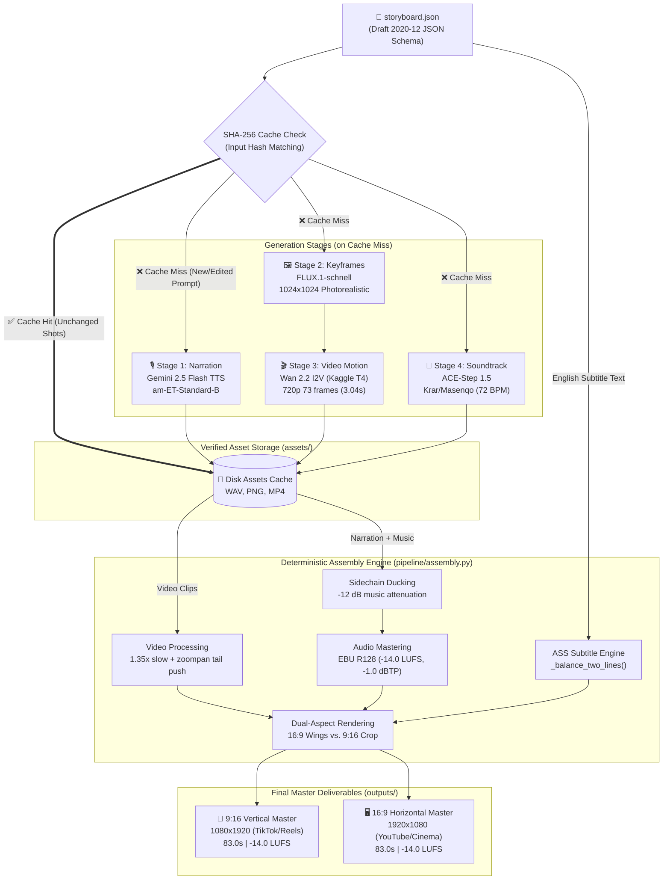
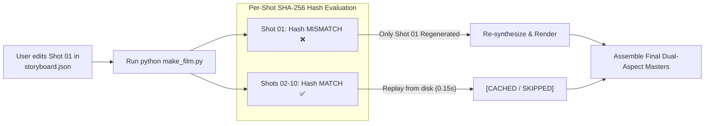
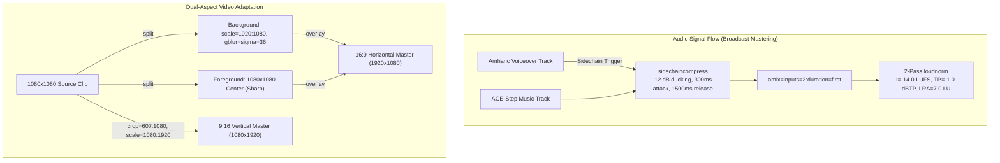

# System Architecture & Pipeline Dataflow

> **Status:** **Production Ready (100% Complete & Verified)**. Fully implemented and deterministic. Dual-aspect exports (`outputs/vertical/harar_monument_vertical_9x16.mp4` and `outputs/horizontal/harar_monument_horizontal_16x9.mp4`) are generated via `python make_film.py`.

---

## 1. Visual Pipeline Architecture

---

## 2. Selective Regeneration & Caching Flow (Demo in Walkthrough)

---

## 3. Core Production Contract: `storyboard.json`
`storyboard.json` is the sole source of truth connecting every stage of the pipeline:
* **Strict Validation (`schema/storyboard.schema.json`):** Evaluated against JSON Schema Draft 2020-12 prior to execution. Validates shot order (1–10), required Amharic narration, timing boundaries (60–90s total), and camera motion vectors.
* **Deterministic Parameterization:** Camera directions (`zoom_in`, `pan_left`, `static_hold`), seeds, and visual tags are declared declaratively without any hardcoded logic in the Python code.

---

## 4. Pipeline Stages & Production Tools

| Stage | Tool / Model | Technical Role | Input / Output |
| :--- | :--- | :--- | :--- |
| **1. Storyboard** | **Draft 2020-12 JSON Schema** | Central production contract and validation gate. | `storyboard.json` $\to$ validated runtime state |
| **2. Narration** | **Gemini 2.5 Flash TTS** (`am-ET-Standard-B`) | Authentic Amharic first-person narration. 21s pacing. | Amharic text $\to$ `assets/narration/` (WAV) |
| **3. Keyframes** | **FLUX.1-schnell** (Hugging Face) | Photorealistic historical and modern keyframes. | Prompts $\to$ `assets/keyframes/` (1024×1024 PNG) |
| **4. Video Motion** | **Wan 2.2 720p** (Kaggle T4) | Image-to-video motion dynamics (73 frames @ 24fps). | Keyframes $\to$ `assets/video/` (MP4) |
| **5. Soundtrack** | **ACE-Step 1.5** | Melancholic traditional Ethiopian krar/masenqo pentatonic score. | Timing/mood $\to$ `assets/music/` (MP4/WAV) |
| **6. Assembly** | **FFmpeg + Pillow** | Temporal extension, sidechain ducking (-12dB), EBU R128 mastering, ASS subtitles, dual-aspect exports. | Assets $\to$ `outputs/vertical/` & `outputs/horizontal/` |

---

## 5. Audio & Visual Signal Processing Architecture

---

## 6. Reproducibility, Caching & Telemetry
1. **Input-Hash Caching:** SHA-256 signatures of prompts, seeds, and durations. If unchanged, generation is bypassed in **0.15s**.
2. **Structured Execution Logging (`runs.jsonl`):** Records timestamp, stage, latency, parameters, and cache hit/miss status for every model invocation.
3. **Single-Command Entry Point:** `python make_film.py` runs validation, checks cache, and builds both aspect ratios end-to-end.
